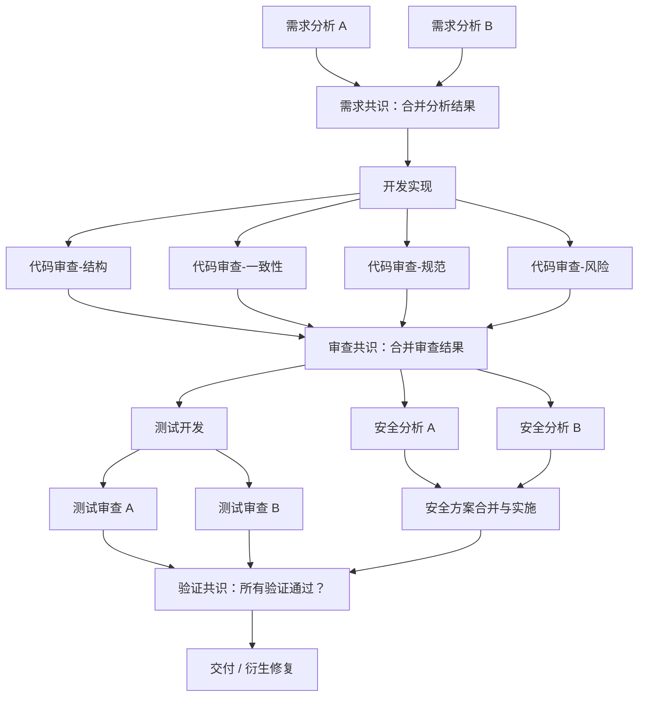

# 指导文件（guide.md）设计

## 1. 当前问题

prompt 模板（init/continue/resume/fix）告诉 agent 做什么，但没有告诉 agent 怎么做：

| 行为 | 模板中的当前指导 | 缺失 |
|------|------------------|------|
| 任务分解 | "分解为具体、可操作的子任务" | 什么粒度？先粗后细还是一步到位？什么时候该拆、什么时候直接做？ |
| 节点描述 | 无 | summary 和 description 该写成什么样？多详细？包含什么？ |
| 结果反馈 | "写 result_summary"、"写 failure_reason" | 写什么内容？什么结构？什么信息是下游必须的？ |
| 执行决策 | 无 | 拿到节点后先做什么？前驱信息不够怎么办？遇到困难是继续还是停下？ |
| 错误处理 | "不原地重试，创建新节点" | 什么时候该创建修复节点？什么时候该直接 fail？fail 时怎么描述问题让后续能修？ |
| 衍生节点 | 无 | 什么情况下应该 add 新节点？怎么设置依赖关系？ |

agent 看到的只有：ready 节点列表（id + summary）+ skills 文档。完整的 description 和前驱结果需要自己通过 `get` 命令去取。这是设计意图（保持 prompt 轻量），但要求 agent 有明确的工作流程指导。

---

## 2. 设计原则

基于调研发现，指导文件的设计遵循以下原则：

### 2.1 Prompt 优化 > Agent 数量

MASS (Google, ICLR 2026) 证明 prompt 质量（84%）比 agent 数量扩展（76%）更有效。指导文件是 Kerrigan 最重要的"prompt"，其质量直接决定系统效果。

### 2.2 详细程度存在最优点

Prompt Specificity 研究 (IJCNLP 2025) 发现详细程度有三段式曲线：上升→平台→过载下降。指导文件不应该面面俱到，应该抓住关键驱动力：**I/O 规格、边界情况处理、分步工作流**。

### 2.3 结构化产物 > 自由文本

MetaGPT (ICLR 2024) 证明结构化文档（可执行性 3.75）远优于自由对话（2.1）。result_summary 和 failure_reason 应该有明确的结构模板。

### 2.4 失败时再分解 > 预先原子化

ADaPT (NAACL 2024) 证明递归细分（+28%）优于静态预分解。指导文件应该鼓励粗粒度起步，而非一开始就拆到最细。

### 2.5 执行反馈 > 讨论

运行时调试研究 (2025) 证明实际执行反馈（63.86%）比多 agent 讨论（57.16%）更有效。指导文件应该强调"先做、根据结果调整"，而非过度规划。

### 2.6 不绑定角色

Kerrigan 的核心设计是"事决定人"——没有固定的 Tester/Developer 等角色。指导文件面向的是**任意 agent 执行任意节点**的场景，不应该预设角色分工。

---

## 3. 整体架构

### 3.1 存储位置

指导文件位于 `~/.kerrigan/shared/` 目录下（全局公共区域，不属于任何单个任务）。

注：当前每个任务目录下都有一个 `shared/` 文件夹，这个设计冗余——移除任务级 `shared/`，改为全局 `~/.kerrigan/shared/` 统一管理。

### 3.2 渐进式披露

指导文件不是一个大文件，而是一个**索引 + 子文档**的结构。agent 不需要一次性读完所有指导——根据当前任务类型，只读取相关的子文档。

```text
~/.kerrigan/shared/
├── guide.md                          # 主索引：通用原则 + 子文档引用
├── guide-software-development.md     # 软件开发管理指南
├── guide-research.md                 # 信息收集调研指南
├── guide-decision-ab-testing.md      # 方案决策与 AB 测试指南
└── guide-git-management.md           # Git 并行开发管理指南
```

主索引 `guide.md` 包含：
- 所有场景通用的原则和要求
- 结构化产物模板（输入/输出规范）
- 每个子文档的**动态绝对路径**和**什么时候需要阅读**的说明

任务通常是多种类型的排列组合（一个软件项目既涉及开发、也涉及调研、也涉及决策）。agent 需要阅读所有与当前任务相关的子文档。

### 3.3 优先级

全部实现：
1. `guide.md`（主索引 + 通用原则）
2. `guide-software-development.md`（软件开发管理）
3. `guide-research.md`（信息收集调研）
4. `guide-decision-ab-testing.md`（方案决策与 AB 测试）
5. `guide-git-management.md`（Git 并行开发管理）

---

## 4. 通用原则（guide.md 主索引）

### 4.1 结构化产物模板

所有节点的输入和输出都应该遵循结构化模板。具体字段参考 MetaGPT 的结构化文档设计（PRD→系统设计→任务列表→代码→测试），但适配 Kerrigan 的 DAG 节点粒度。

**每个节点的 description 必须包含**：
- 目标：这个节点要产出什么
- 上下文：引用哪些前驱节点的结果（node ID）
- 范围：操作哪些文件/目录/资源
- 约束：不该做什么、边界在哪里
- 产出要求：result_summary 中需要包含什么信息

**result_summary 结构模板**：
- 执行摘要（一句话结论）
- 关键产出（具体的、可验证的产出物）
- 对后续节点的建议（下游 agent 需要知道的信息）
- 已知限制与未完成事项（**必须如实披露**：未覆盖的场景、暂时绕过的问题、跳过的测试、做出的妥协、已知但未修复的缺陷。隐瞒比缺陷本身更有害——下游节点会基于错误假设工作）

**failure_reason 结构模板**：
- 失败根因分类（上游输入不足 / 任务描述不清 / 执行能力不足 / 外部依赖）
- 已尝试的方法（做了什么、走到哪一步）
- 建议修复方向（增加什么节点、补充什么信息）

### 4.2 先做后分解

**核心：执行和调研大于讨论，失败或遇到问题再分解大于预先分解。**

- **不要预测两步以外的计划。** 第一轮只做粗粒度分解（2-3 个高层节点），后续轮次根据执行结果决定是否继续细化。
- **先做再说，但小规模试探。** 如果不确定一个任务是否需要进一步拆分，先做——但不要全量实施，而是做一个最小范围的尝试，验证思路是否可行、复杂度是否可控。确保每一步都可以及时回退，不会错得太远、花费太多时间。发现复杂度超出预期时，立即停下来分解为子节点，而非硬撑到底。
- **实践前先验证可行性。** 在真正动手实施之前，先对方案的可行性进行理论验证——通过多个独立的交叉验证节点，从不同角度评估方案是否可行、依赖是否满足、假设是否成立。确保分解出来的每个子任务都有实践依据，而不是基于未经验证的假设。这不是"过度规划"——这是用最小成本排除不可行路径，避免在错误方向上全力投入。
- **已有计划可以随时重构。** DAG 不是一成不变的——发现之前的分解方式不合理时，可以 add 新节点、建立新的依赖关系来调整路径。
- **不要在没有调查和实践的前提下进行过多的原子化分解。** 过度提前细化的计划大多是幻想——缺乏实践依据的规划只是在猜测，而猜错的代价是整棵子树全部作废。过度细分的 DAG 不仅增加协调开销，还会让每个节点的上下文碎片化。

依据：ADaPT (NAACL 2024) 失败再分解 +28%，SOEN-101 (ICSE 2025) 迭代 sprint +15%，ClassEval 研究证明过度流程化对强模型反而有害 -37.8%。

### 4.3 任务有类别，但不绑定角色

Kerrigan 框架层面已经解决了"不绑定角色"——没有固定的 Tester/Developer agent。但每个任务节点仍然有自己的**类别**（分析、实现、测试、调研等）。

在 dispatch subagent 时，可以根据节点的类别在 prompt 中描述身份，帮助 agent 理解任务的重心和目的。例如：
- 分析类节点：告诉 subagent "你是一个代码分析师，目标是..."
- 实现类节点：告诉 subagent "你是一个开发者，目标是..."
- 审查类节点：告诉 subagent "你是一个独立审查员，目标是找出问题..."

这不是固定角色分配，而是**临时身份描述**——同一个 agent 在不同节点中扮演不同身份。

### 4.4 透明披露原则

**不隐瞒任何已知问题。** 没有做的、暂时绕过的、跳过的测试、做出的妥协、已知但未修复的缺陷——全部如实写在 result_summary 的"已知限制"中。

这是 DAG 可追溯性的基石。隐瞒比缺陷本身更有害：
- 下游节点会基于错误假设工作，产生级联错误
- 责任追溯时无法定位真正的根因
- 自演化循环无法学习到真实的失败模式

具体要求：
- 如果跳过了某些测试用例 → 写明哪些、为什么跳过
- 如果绕过了某个错误 → 写明绕过方式和潜在风险
- 如果做了妥协（如用了不够优雅的方案）→ 写明妥协原因和更好方案的方向
- 如果有 TODO / FIXME → 在 result_summary 中体现，不要只留在代码注释里

### 4.5 交叉验证原则

**不单独相信任何一个任务的结果，一定要有多角度的交叉验证。**

这是贯穿所有子指南的核心原则。具体表现为：
- 代码审查：独立于开发者的多次审查
- 测试：独立于开发者的测试设计和测试审查
- 调研：多个独立信息源的交叉验证
- 决策：AB 测试的交叉审核

在 DAG 层面，交叉验证表现为：多个**独立的**节点对同一问题做出判断，然后由一个聚合节点比对结论。如果结论一致，可信度高；如果不一致，衍生进一步调查节点。

### 4.5 子文档引用

主索引中列出所有子文档的动态绝对路径和触发条件：

```text
## 场景指南

任务通常是多种类型的排列组合。请根据当前任务涉及的类型，阅读对应的指南。

- **软件开发管理** → `{{ shared_dir }}/guide-software-development.md`
  当任务涉及代码编写、修改、测试时阅读

- **信息收集调研** → `{{ shared_dir }}/guide-research.md`
  当任务涉及调查研究、竞品分析、技术选型时阅读

- **方案决策与 AB 测试** → `{{ shared_dir }}/guide-decision-ab-testing.md`
  当任务涉及方案比较、技术选型验证、效果评估时阅读

- **Git 并行开发管理** → `{{ shared_dir }}/guide-git-management.md`
  当任务涉及多个 feature 并行开发、代码合并时阅读
```

---

## 5. 软件开发管理指南（guide-software-development.md）

### 5.1 总体模式：小步快跑的迭代

借鉴 Scrum 模式，但不是完整的 Scrum——重点是**小步迭代**和**多角度质量保证**。

**每个 feature 的大小控制**：一个 feature 应该是"一次可以完整交付并测试的最小有意义变更"。如果一个 feature 的 description 超过 500 字还说不清楚，它太大了——应该拆分。

**迭代节奏**：
1. 分析需求 → 2. 实现 → 3. 多角度验证 → 4. 交付
每个迭代都是完整的"分析-实现-验证"闭环，不允许跳过验证直接交付。

**方案决策**：每个涉及技术选型或方案设计的工作，都需要符合方案决策与 AB 测试的流程指南（引用 `{{ shared_dir }}/guide-decision-ab-testing.md`）。

### 5.2 必须的子任务类型

每个开发迭代中，以下子任务是**必须的**，且验证类任务要求**多个独立节点从不同角度分别执行**以实现交叉验证：

#### 需求分析（独立多次）

验证需求本身的合理性：
- 需求内部是否存在矛盾
- 与现有系统的功能是否有冲突
- 是否符合小步快跑原则（如果一个需求需要改动 10+ 文件，应该考虑拆分）
- **如果发现不可调和的矛盾，中断执行**，通过 failure_reason 报告矛盾所在

#### 开发实现

实际的代码编写。要求：
- 遵循项目已有的代码风格和架构模式
- 每次修改尽量原子化——一个 commit 做一件事

#### 静态代码审查（独立多次）

独立于开发者的代码审查。每次审查关注不同维度：
- **结构审查**：过度嵌套、不合理的抽象层次、不必要的复杂度（但不要过度追求抽象——只在确实影响可维护性时提出重构需求，而非预防性重构）
- **一致性审查**：逻辑与注释不一致、实现与需求描述不一致、与现有功能行为不一致
- **规范审查**：命名规范、错误处理模式、日志规范
- **风险审查**：从静态分析角度识别潜在的安全漏洞（注入、越权、信息泄露）、可能导致系统崩溃的路径（未处理的异常、资源泄漏、死锁）、明显的性能问题（N+1 查询、不必要的全量遍历、内存爆炸）

关键：审查者不应该知道"开发者认为哪里可能有问题"——审查必须是独立的、无偏见的。

#### 测试开发

编写测试用例。要求：
- 覆盖正常路径和异常路径
- 包含边界条件测试
- 测试应该是可以**独立运行**的

#### 测试审查（独立多次）

独立于测试开发者的测试质量审查。检查：
- 是否存在**假测试**——测试永远通过，实际上没有验证任何东西
- 是否存在**无效断言**——断言条件过于宽泛，无法捕捉回归
- 是否存在**遗漏场景**——关键路径、异常路径、并发场景是否被覆盖
- 测试的**可维护性**——测试是否过于依赖实现细节

#### 安全分析（独立多次）

从安全视角审视代码。分为两个阶段：

**阶段一：独立分析（并行，不修改代码）**
- **白盒分析**：阅读代码，识别潜在的注入、越权、信息泄露风险
- **对抗性分析**：分析哪些输入能触发程序崩溃、数据损坏或安全漏洞
- **断言位置提案**：提出应该在哪些关键位置添加防御性断言（防止 silent failures），但此阶段**只提方案、不改代码**
- 多个独立分析节点各自产出提案，可参考 OWASP Top 10、CWE 等经典框架

**阶段二：方案合并与实施（串行，在分析完成后）**
- 汇聚所有独立分析的提案（断言插入、代码加固、测试用例等），合并为一个没有异议的修改方案
- 有分歧的位置需要讨论达成共识后再执行
- 由单一节点执行实际的代码修改，避免多个节点并行修改同一份代码产生冲突

**通用规则：任何需要修改源码的验证手段**（插入断言、添加日志探针、注入 fuzzing harness、修改配置进行压测等），都遵循同样的两阶段模式——先并行独立提案，再串行合并实施。分析阶段不碰代码，实施阶段单点执行。

### 5.3 DAG 拓扑模式

一个典型的开发迭代 DAG：



注意：这不是固定模板——agent 应该根据实际情况调整。对于简单的修改（如修复一个 typo），不需要完整的审查和安全分析流程。**复杂度应该与变更的风险成正比。**

---

## 6. 信息收集调研指南（guide-research.md）

### 6.1 调研流程

系统性调研的核心是：**多源独立收集 → 交叉验证 → 实证检验 → 结构化报告**。

#### 6.1.1 多角度信息收集（独立多个，并行）

对调查选题进行充分联想，从不同角度切入，例如：
- 学术视角：论文、survey、benchmark
- 工业视角：产品、开源项目、技术博客
- 社区视角：论坛讨论、用户反馈、GitHub issues/stars
- 历史视角：技术演进、前代方案的成败

每个角度由**独立的节点**执行，互不参照——确保收集到的信息是独立的，而非一个节点影响另一个节点的判断。

#### 6.1.2 交叉验证

多个收集节点的结果汇聚后，进行交叉验证：
- 不同来源的信息是否一致？
- 有没有互相矛盾的发现？
- 矛盾之处是否需要进一步调查？

#### 6.1.3 实际体验与实验

**凡是可操作、可交互的（能下载的工具、能找到源码的、能在线体验的），必须进行实际体验和实验。**不能只依赖文档和他人的评测。

实验报告要求：
- **可证伪性**：明确说明在什么条件下实验结论会被推翻
- **可重现性**：记录环境、版本、参数，让他人能重现
- **定量对比**：使用该领域的关键参数进行量化对比

不同领域的关键参数示例：
- 数据库：性能（QPS/TPS）、响应时间（P50/P99）、吞吐量、资源占用（CPU/内存/磁盘）
- 社交产品：用户量、日活/月活、社区活跃度、口碑评价
- API 服务：支持的接口类型、数据准确性、延迟、时效性、SDK 生态、鉴权方式
- 开发工具：安装复杂度、学习曲线、文档质量、社区支持

使用表格进行多产品横向对比。如果涉及性能数据，绘制对比图表。

#### 6.1.4 涉及代码开发的实验

如果实验过程中需要编写代码（如 benchmark 脚本、对比测试），**必须遵循软件开发管理指南**（引用 `{{ shared_dir }}/guide-software-development.md`）。实验代码也需要质量保证。

### 6.2 调查报告标准

一个合格的调查报告必须包含：

- **调查背景**：为什么要调查这个问题，调查的目标和边界
- **方法论**：用了什么方法收集和验证信息
- **核心发现**：按主题组织，每个发现都要标注信息来源
- **实证数据**：定量数据优先于定性描述。有实验的附实验报告
- **交叉验证结果**：不同信息源之间的一致性分析
- **局限性**：本次调查未能覆盖的范围、可能存在的偏差
- **结论与建议**：可操作的结论，避免模棱两可

**不合格的调查报告**：
- 只引用了单一来源
- 没有区分事实和观点
- 数据没有时效性标注（什么时候的数据？）
- 结论无法证伪（怎么判断结论是对的？）

---

## 7. 方案决策与 AB 测试指南（guide-decision-ab-testing.md）

### 7.1 核心思路

当面临多个方案选择时，不应该通过讨论来决定——应该通过**实验**来验证。讨论是廉价的，实验才有说服力。

适用场景：
- 技术选型（用框架 A 还是框架 B？）
- 架构决策（方案 A 性能优先 vs 方案 B 可维护性优先？）
- 算法/策略选择（分词方式 A vs B？缓存策略 A vs B？）
- 配置调优（参数 X 设多少合适？）
- 指导文件自身的优化（指导文件 v1 vs v2 哪个效果好？）

### 7.2 决策流程

```text
[明确决策问题] → [定义候选方案] → [设计实验]
    → [独立实施 A 组]（并行）
    → [独立实施 B 组]（并行）
    → [收集数据]
    → [独立分析 1]（并行）
    → [独立分析 2]（并行）
    → [交叉审核：对比两个独立分析的结论]
    → [形成决策报告]
```

关键：**实施和分析都要有独立多次的交叉验证。** 不能让同一个 agent 既做实验又分析结果——自己验证自己是最常见的失效模式。

### 7.3 实验设计要求

- **明确假设**：用可证伪的形式陈述（"方案 A 的 P99 延迟低于方案 B"，而非"方案 A 更好"）
- **控制变量**：除被测变量外，其他条件必须一致（同一数据集、同一硬件、同一负载模式）
- **样本量**：如果是随机性测试，需要足够的重复次数以达到统计显著性
- **评估指标**：
  - 主要指标：直接衡量决策目标的指标（如性能、正确率）
  - 辅助指标：需要关注但不作为决策依据的指标（如资源消耗、代码复杂度）
  - 护栏指标：不能变差的底线指标（如安全性、兼容性）

### 7.4 AB 测试报告标准

```text
## 决策问题
[一句话描述要解决什么问题]

## 候选方案
- 方案 A：[描述]
- 方案 B：[描述]

## 假设
[可证伪的假设陈述]

## 实验设计
- 环境：[硬件/软件/数据集]
- 控制变量：[列举]
- 变量：[被测差异]
- 重复次数：[N]

## 原始数据
[表格或数据附件]

## 统计分析
- 主要指标对比：[A vs B，含置信区间]
- 辅助指标对比：
- 护栏指标检查：

## 交叉审核结果
- 独立分析 1 结论：[...]
- 独立分析 2 结论：[...]
- 一致性：[一致 / 分歧及原因]

## 结论
[基于数据的决策建议，明确置信度]

## 局限性
[本次实验未能覆盖的场景、可能影响结论的因素]
```

### 7.5 不合格的决策

以下情况应该打回重做：
- 没有实验数据，仅凭"理论上应该更好"做决策
- A/B 组的环境不一致
- 只看了主要指标，忽略了护栏指标的恶化
- 只有一次分析、没有交叉审核
- 结论中使用模糊措辞（"可能"、"应该"）而非数据支撑的判断

---

## 8. Git 并行开发管理指南（guide-git-management.md）

### 8.1 核心问题

Kerrigan 的 DAG 天然支持并行执行。当多个开发节点并行修改同一个 repo 时，需要隔离策略来避免冲突。

### 8.2 隔离策略：独立克隆

避免使用 git worktree（状态复杂、容易出错、对 agent 的 git 心智模型要求高）。采用**独立克隆**策略——每个并行 feature 就像在不同主机上开发：

```text
workspace/
├── track-1/               # 并行轨道 1
│   └── repo/
├── track-2/               # 并行轨道 2
│   └── repo/
└── track-3/               # 并行轨道 3
    └── repo/
```

每个轨道是一个独立的 repo clone，彼此等价——就是 N 条可并行的开发轨道。需要几条并行就创建几个。轨道是长期复用的：一个 feature 完成合并后，拉取最新 main 即可继续下一个 feature，不需要重新克隆。

orchestrator 在分配开发节点时，在节点 description 中指定使用哪条轨道（如 "在 track-2 上开发"），确保同一时刻每条轨道上只有一个 feature 在进行。

每条轨道独立操作：
- 各自创建 feature branch、commit、push
- 互不干扰
- feature 完成合并后，切回 main、pull 最新、接下一个任务

### 8.3 分支管理

- **分支命名**：`feature/<短描述>`，如 `feature/add-auth-middleware`
- **控制与主分支的距离**：feature branch 不应该与主分支产生过大的差距。每完成一个小步骤就应该考虑是否可以合并，或至少拉取主分支的最新更改到当前分支。分支存活时间不是关键——关键是 diff 的大小和与主分支的偏离程度
- **及时合并**：feature 完成并通过验证后，立即合并到主分支。如果 feature 太大无法快速合并，说明应该拆分为更小的 feature

### 8.4 合并流程

```text
[feature 开发完成]
  → [在 feature branch 上跑 CI/测试]
  → [合并审查]（独立多个：从其他并行分支视角、从各依赖模块视角、从整体架构视角分别审视合并是否会引入冲突或破坏）
  → [审查一致通过 → 直接合并到主分支]
  → [删除 feature branch]
  → [其他并行 feature rebase 到最新主分支]
```

最后一步很关键：**每次有 feature 合并到主分支后，其他正在进行的 feature 都应该 rebase**，尽早暴露冲突。

### 8.5 冲突处理

当两个并行 feature 修改了同一个文件：
- 先合并的 feature 优先
- 后合并的 feature 需要 rebase 并解决冲突
- 冲突解决后需要重新跑测试
- 如果冲突难以解决，说明最初的任务分解有问题——这两个 feature 之间存在未识别的隐含依赖。此时应该回退相关变更，重新审视 DAG 拓扑：可能需要建立依赖关系改为串行，也可能需要重新划分 feature 边界，甚至重构整个子 DAG 的分解方案

### 8.6 与 DAG 的配合

在 DAG 中规划并行开发节点时：
- 如果两个 feature 修改的文件集合**完全不重叠**——独立克隆，安全并行
- 如果有**部分重叠但修改量小**——可以在同一个 clone 下用不同分支分别开发，合并时处理冲突
- 如果有**大量重叠**——串行执行更安全，或者重新划分 feature 边界减少重叠

orchestrator 在分解任务时应该分析文件修改范围，据此选择隔离策略（独立克隆 / 同 clone 不同分支 / 串行）。

---

## 9. 与 prompt 模板的关系

指导文件和 prompt 模板是**互补**关系：

| prompt 模板 | 职责 | guide.md | 职责 |
|------------|------|----------|------|
| init.md | "你是 orchestrator，分解任务" | §4.2 先做后分解 | 怎么分解、什么粒度 |
| continue.md | "这些节点 ready 了" | 执行工作流 | 拿到节点后的标准流程 |
| resume.md | "新 session，先了解状态" | 同上 | 同上 |
| fix.md | "DAG 有这些问题" | §4.1 结构化模板 | 怎么写合格的 result/failure |
| — | — | 子指南 | 按任务类型提供分解策略 |

**注入方式**：prompt 模板中加一行引用路径，init.md 中强引导"请先阅读指导文件"，continue/resume 中不重复。不把 guide.md 全文注入 prompt（太长），让 agent 按需自行阅读。

---

## 10. 部署方式

1. 指导文件源码存放在 `kerrigan-storage/shared/` 目录下（与 skills 并列）
2. 通过 `include_str!` 编入 kerrigan-storage 二进制
3. `kerrigan-storage init` 时部署到 `~/.kerrigan/shared/`
4. prompt 模板通过 `{{ guide_path }}` 注入主索引路径
