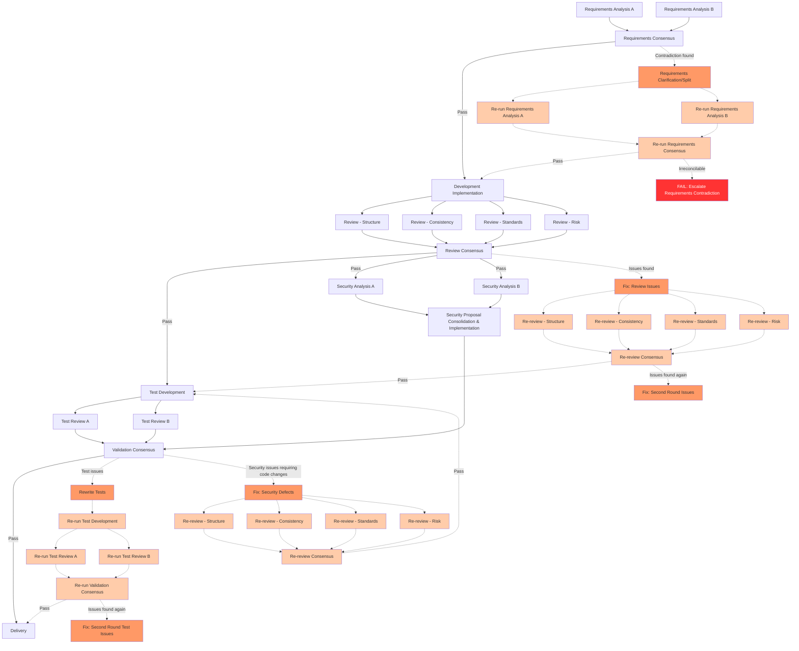

# Software Development Management Guide

## Overall Approach: Small-Step Iteration

### Mapping Features to Branches

Each external feature request corresponds to a single feature branch in git. If the feature is too large, break it down into subtasks, each with its own sub-branch off the feature branch. This is **recursive** — if a sub-branch is still too large, continue splitting into sub-sub-branches.

**Splitting criteria** (auxiliary guidelines — split if any one is met):
- The description exceeds 500 words and still cannot clearly specify what needs to be done
- The estimated changes span more than 10 files or 200 lines of code

**Completion is a backtracking process**: the lowest-level sub-branch is completed → merged into the parent feature branch → the parent performs integration validation → backtracking continues → the top-level feature branch is delivered as a whole → then a decision is made on how to merge into the main branch.

```text
main
 └── feature/add-auth                          ← external requirement
      ├── feature/add-auth/middleware           ← subtask
      │    ├── feature/add-auth/middleware/jwt     ← further split
      │    └── feature/add-auth/middleware/session
      └── feature/add-auth/tests

Backtrack merge: jwt → middleware → add-auth → (validate) → main
```

### Relationship Between Parallel Tracks and the Branch Tree

Parallel tracks are **execution resources** and are not restricted to a specific task level. At any given moment, each track executes either a **leaf node** in the branch tree (the lowest-level incomplete sub-branch) or a **feature node whose child nodes have all been merged and is ready for integration work at its own level**. A track never holds a "large feature that hasn't been fully broken down yet."

For detailed operations on branch management, parallel tracks, and merge workflows, refer to `{{ shared_dir }}/guide-git-management.md`.

### Size Control for Each Feature

Each feature that is ultimately implemented (a leaf node of the branch tree) should be "the smallest meaningful change that can be fully delivered and tested in one pass."

**Iteration loop**: analyze requirements → implement → validate from multiple angles → deliver. Skipping validation and delivering directly is not allowed.

Any work involving technology selection or solution design must follow the decision-making and A/B testing workflow guide (`{{ shared_dir }}/guide-decision-ab-testing.md`).

---

## Required Subtask Types

Validation tasks require **multiple independent nodes executing separately from different angles** to achieve cross-validation.

### Requirements Analysis (Independent, Multiple Times)

Verify the reasonableness of the requirements themselves:
- Whether the requirements contain internal contradictions
- Whether they conflict with the existing system
- Whether they comply with the small-step iteration principle (changes spanning 10+ files should be considered for splitting)
- **When irreconcilable contradictions are found, halt execution** and report via failure_reason

### Development Implementation

- Follow the project's existing code style and architectural patterns
- Keep each change as atomic as possible — one commit does one thing

### Static Code Review (Independent, Multiple Times)

Independent from the developer, each review focuses on a different dimension:
- **Structural review**: excessive nesting, unreasonable abstractions (only propose refactoring when it genuinely affects maintainability — no preventive refactoring)
- **Consistency review**: logic inconsistent with comments, implementation inconsistent with requirements, behavior inconsistent with existing functionality
- **Standards review**: naming conventions, error handling patterns, logging standards
- **Risk review**: security vulnerabilities (injection, privilege escalation, information leakage), crash paths (unhandled exceptions, resource leaks, deadlocks), performance issues (N+1 queries, unnecessary full scans, memory blowups)

Key point: reviewers should not know where the developer thinks problems might exist — reviews must be independent and unbiased.

### Test Development

- Cover both normal and exception paths
- Include boundary condition tests
- Tests should be able to run independently

### Test Review (Independent, Multiple Times)

Independent from the test developer, check for:
- **Fake tests**: tests that always pass but don't actually verify anything
- **Invalid assertions**: assertion conditions that are too broad
- **Missing scenarios**: whether critical paths, exception paths, and concurrency scenarios are covered
- **Maintainability**: whether tests are overly coupled to implementation details

### Security Analysis (Independent, Multiple Times, Two Phases)

**Phase 1: Independent Analysis (Parallel, No Code Modifications)**
- White-box analysis: identify injection, privilege escalation, and information leakage risks
- Adversarial analysis: determine which inputs could trigger crashes, data corruption, or security vulnerabilities
- Assertion placement proposals: suggest where defensive assertions should be added (to prevent silent failures) — **propose only, do not modify code**
- Multiple independent analysis nodes each produce their own proposals; may reference OWASP Top 10, CWE

**Phase 2: Proposal Consolidation and Implementation (Sequential, After Analysis Is Complete)**
- Aggregate all proposals and merge into a set of uncontested changes
- Discuss and reach consensus on disputed items before execution
- A single node executes the code modifications to avoid parallel conflicts

**General rule**: any validation method that requires modifying source code (assertions, logging probes, fuzzing harnesses, stress test configurations, etc.) follows the "parallel proposals → sequential implementation" two-phase model.

---

## DAG Topology Reference



**Legend**: solid lines = normal flow, dashed lines + orange nodes = rework paths spawned when reviews find issues.

**Key rules**:
- When any phase (requirements analysis, code review, test review, security analysis) finds issues, **do not return to the original node** (each node executes only once). Spawn a "fix" node, and after the fix is complete, enter a **full re-validation** (independent, multiple times, at the same rigor as the first pass).
- If re-validation finds more issues, continue spawning fix nodes — recurse until all checks pass.
- When security analysis identifies a need for code changes, the fix must go back to the code review phase and re-run the full workflow (because the code has changed).
- When irreconcilable contradictions are found during requirements analysis, fail immediately and escalate — do not spawn fix nodes.

This is not a fixed template — adjust based on actual circumstances. Fixing a typo does not require a full review and security analysis workflow. **Complexity should be proportional to the risk of the change.**
