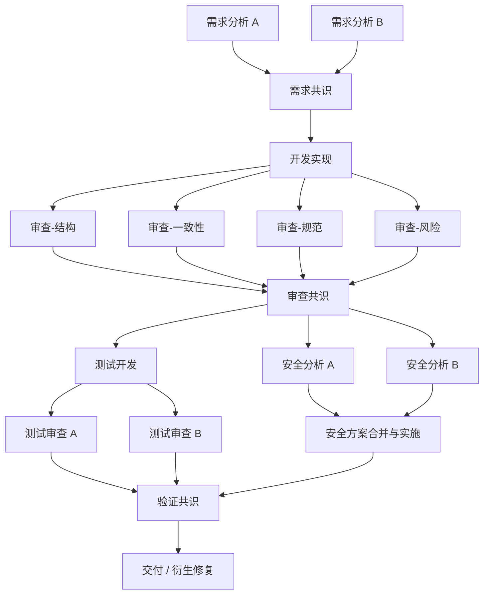

# 软件开发管理指南

## 总体模式：小步迭代

每个 feature 应该是"一次可以完整交付并测试的最小有意义变更"。description 超过 500 字还说不清楚，说明太大了——应该拆分。

**迭代闭环**：分析需求 → 实现 → 多角度验证 → 交付。不允许跳过验证直接交付。

每个涉及技术选型或方案设计的工作，需要符合方案决策与 AB 测试的流程指南（`{{ shared_dir }}/guide-decision-ab-testing.md`）。

---

## 必须的子任务类型

验证类任务要求**多个独立节点从不同角度分别执行**以实现交叉验证。

### 需求分析（独立多次）

验证需求本身的合理性：
- 需求内部是否存在矛盾
- 与现有系统是否有冲突
- 是否符合小步迭代原则（改动 10+ 文件应考虑拆分）
- **发现不可调和的矛盾时，中断执行**，通过 failure_reason 报告

### 开发实现

- 遵循项目已有的代码风格和架构模式
- 每次修改尽量原子化——一个 commit 做一件事

### 静态代码审查（独立多次）

独立于开发者，每次关注不同维度：
- **结构审查**：过度嵌套、不合理的抽象（只在确实影响可维护性时提出重构，不做预防性重构）
- **一致性审查**：逻辑与注释不一致、实现与需求不一致、与现有功能行为不一致
- **规范审查**：命名规范、错误处理模式、日志规范
- **风险审查**：安全漏洞（注入、越权、信息泄露）、崩溃路径（未处理异常、资源泄漏、死锁）、性能问题（N+1 查询、不必要的全量遍历、内存爆炸）

关键：审查者不应该知道开发者认为哪里可能有问题——审查必须独立、无偏见。

### 测试开发

- 覆盖正常路径和异常路径
- 包含边界条件测试
- 测试应该可以独立运行

### 测试审查（独立多次）

独立于测试开发者，检查：
- **假测试**：测试永远通过，实际上没验证任何东西
- **无效断言**：断言条件过于宽泛
- **遗漏场景**：关键路径、异常路径、并发场景是否被覆盖
- **可维护性**：测试是否过于依赖实现细节

### 安全分析（独立多次，两阶段）

**阶段一：独立分析（并行，不修改代码）**
- 白盒分析：识别注入、越权、信息泄露风险
- 对抗性分析：分析哪些输入能触发崩溃、数据损坏或安全漏洞
- 断言位置提案：提出应在哪些位置添加防御性断言（防止 silent failures），**只提方案、不改代码**
- 多个独立分析节点各自产出提案，可参考 OWASP Top 10、CWE

**阶段二：方案合并与实施（串行，分析完成后）**
- 汇聚所有提案，合并为没有异议的修改方案
- 有分歧的位置讨论达成共识后再执行
- 由单一节点执行代码修改，避免并行冲突

**通用规则**：任何需要修改源码的验证手段（断言、日志探针、fuzzing harness、压测配置等），都遵循"并行提案→串行实施"的两阶段模式。

---

## DAG 拓扑参考

这不是固定模板——根据实际情况调整。修复 typo 不需要完整的审查和安全分析流程。**复杂度应该与变更的风险成正比。**
